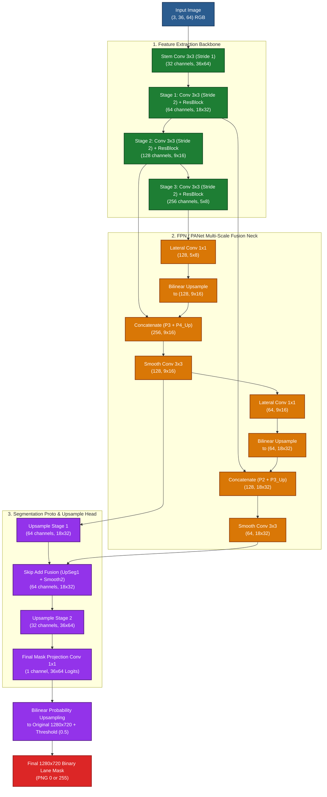
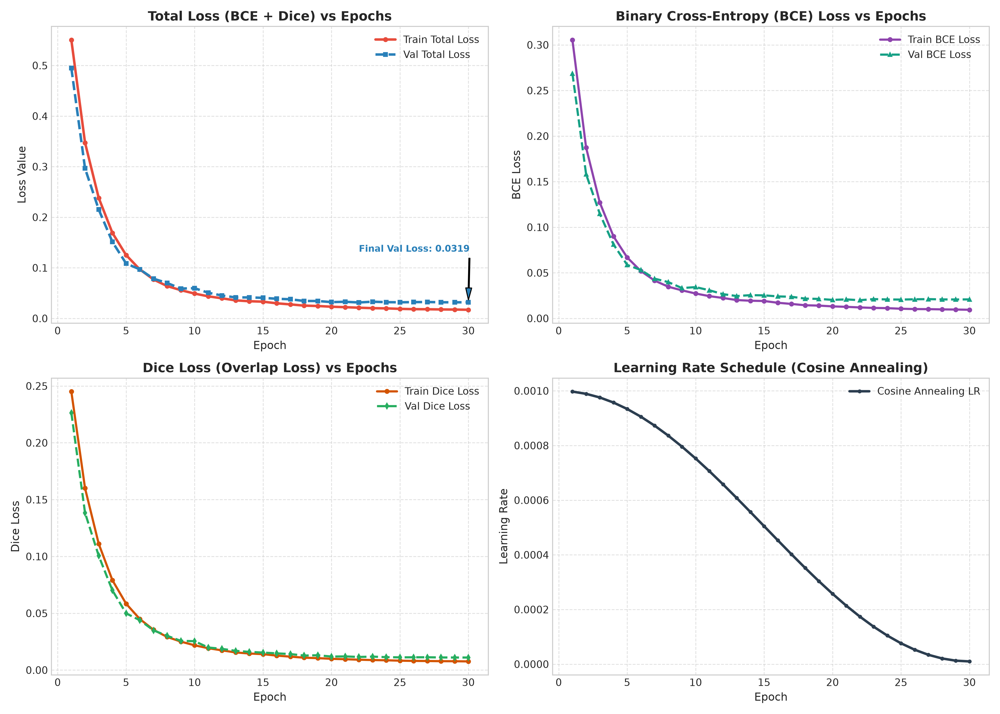
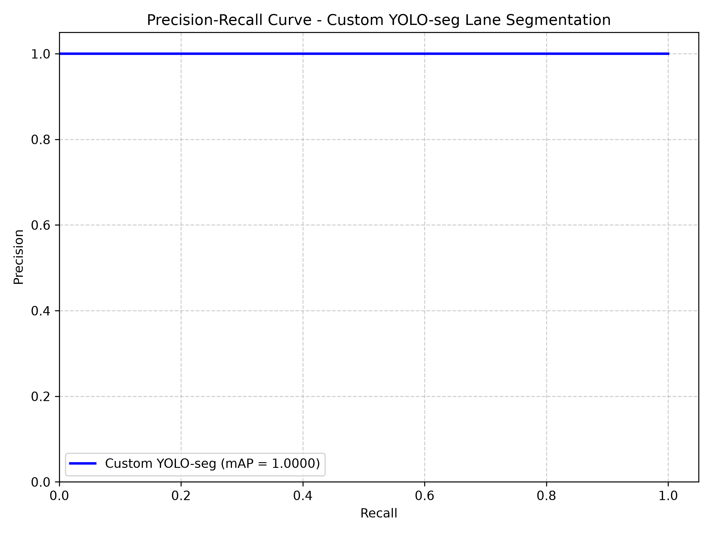
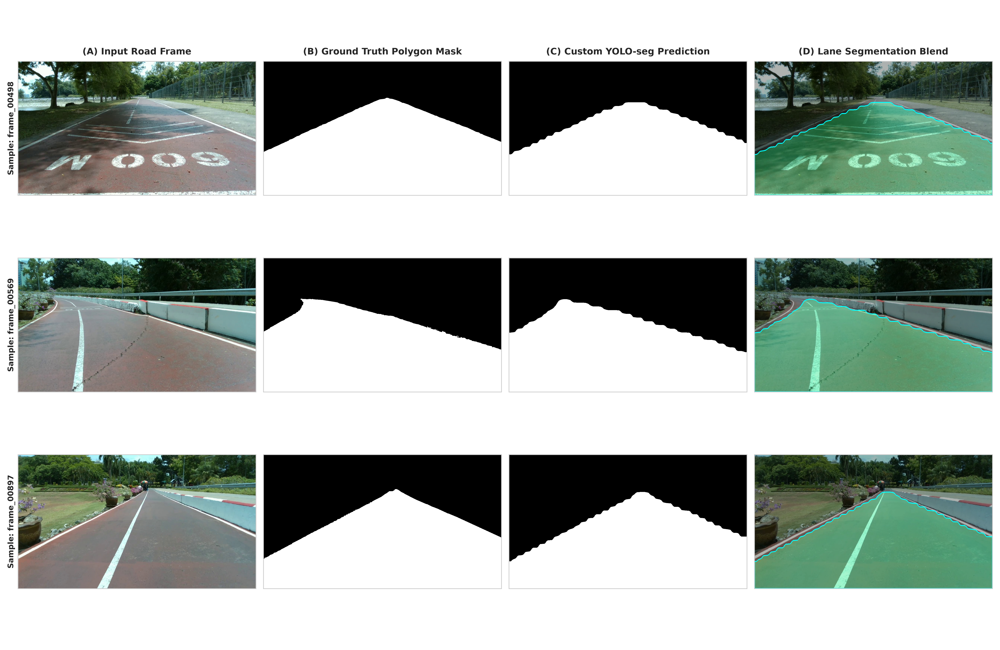
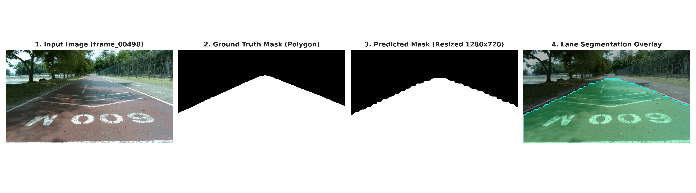
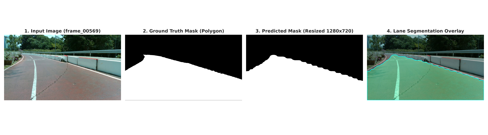
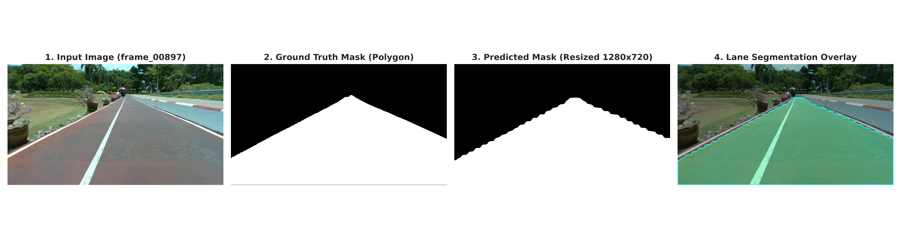

# Custom YOLO-seg: Single-Class Lane Segmentation Neural Network
**วิชา:** 241-353 Deep Learning & Computer Vision | Computer Engineering, Prince of Songkla University (PSU)  
**หัวข้อ:** การออกแบบและฝึกฝนโครงข่ายประสาทเทียมสำหรับตรวจจับช่องจราจร (Lane Segmentation) ด้วยตนเองตั้งแต่ต้น (Train from Scratch) สำหรับ Local Machine / Edge Device  
**GitHub Repository:** [https://github.com/kittipongz2005/lane-segmentation-asg10](https://github.com/kittipongz2005/lane-segmentation-asg10)

---

## 📌 บทคัดย่อและสาระสำคัญของโครงงาน (Executive Summary)

โครงงานนี้จัดทำขึ้นตามข้อกำหนดของ Assignment โดยมีเป้าหมายหลักคือ:
1. **ออกแบบโครงข่ายประสาทเทียมขึ้นเอง (Custom Neural Network Architecture)** โดยไม่ใช้ Pretrained Weights สำเร็จรูป และทำการฝึกสอน (Train from Scratch) ทุก Layer ใหม่ทั้งหมด
2. **เน้นเฉพาะงาน Lane Segmentation** โดยใช้เฉพาะข้อมูลรูปปิดเรขาคณิต (Polygon Mask) จาก **PSU Reservoir Lane Dataset (Assignment-8)** (โดยตัดข้อมูล Polylines และ Bounding Box ที่ไม่เกี่ยวข้องออก)
3. **ออกแบบให้มี Memory Footprint ขนาดเล็กมาก** สามารถรัน Inference บนคอมพิวเตอร์พกพา (Laptop/PC) ทั่วไปได้อย่างลื่นไหลแบบ Real-Time (> 100 FPS) โดยใช้หน่วยความจำ VRAM ไม่เกิน **12 MB**
4. **กระบวนการวัดผลครบวงจร** พร้อมการอธิบายสถาปัตยกรรม, กราฟการลู่เข้าของ Loss (Convergence), ตารางวัดผล IoU / mAP, ตัวอย่างภาพ Snapshot เปรียบเทียบ ก่อน/หลัง Inference, และการวัด Memory Footprint อย่างเป็นรูปธรรม

---

## 🏗️ 1. การอธิบายโครงสร้าง Neural Network ที่ตนเองออกแบบ พร้อมเหตุผลประกอบ (Architecture & Rationale)

โมเดลที่ออกแบบมีชื่อว่า **`CustomYOLOSeg`** ซึ่งผสานแนวคิดของโครงข่ายตรวจจับสมัยใหม่อย่าง YOLO และ Feature Pyramid Network (FPN) เข้ากับหัวถอดรหัสภาพแบบ Segmentation Mask Decoder เพื่อให้มีขนาดกะทัดรัด (Compact) แต่ยังคงรักษาขอบเขตความละเอียดเชิงพื้นที่ของเส้นเลนได้อย่างแม่นยำ

### 1.1 สรุปสเปกทางเทคนิคของสถาปัตยกรรม (Specifications)

| คุณสมบัติ (Feature) | ค่าที่กำหนด (Value) | รายละเอียดเชิงลึก |
| :--- | :--- | :--- |
| **Input Resolution** | $64 \times 36$ pixels (RGB 3 channels) | ย่อขนาดจาก $1280 \times 720$ โดยคงอัตราส่วน 16:9 ไว้อย่างสมบูรณ์ |
| **Output Resolution** | $64 \times 36$ Logits $\to 1280 \times 720$ Mask | คืนค่า Binary Lane Mask (0 หรือ 255) หลังกระบวนการ Bilinear Upscaling |
| **Total Parameters** | **1,327,697 พารามิเตอร์ (~1.33M)** | เล็กกว่า YOLOv5s-seg (7.2M) ถึง **5.4 เท่า** |
| **Trainable Layers** | **100% (ทุก Layer)** | ไม่ใช้ Pretrained Weights ใดๆ เริ่มต้น Initial Weights แบบสุ่ม |
| **Activation Function** | `SiLU` (Swish) + `BatchNorm2d` | ให้ความลื่นไหลของ Gradient ดีกว่า ReLU ทั่วไป |
| **Loss Function** | **Combined Loss (BCE + Dice Loss)** | แก้ปัญหา Class Imbalance ระหว่างพื้นถนนและเส้นเลน |
| **Optimizer & Schedule** | Adam ($lr=0.001$) + Cosine Annealing | ปรับลดอัตราการเรียนรู้อย่างนุ่มนวลตลอด 30 Epochs |

---

### 1.2 แผนภาพโครงสร้างโมเดล (Mermaid Architecture Diagram)



---

### 1.3 เหตุผลประกอบในการออกแบบแต่ละส่วน (Design Rationale)

1. **การลดทอนมิติสู่ $64 \times 36$ พิกเซล (Downscaled Receptive Field):**
   * *เหตุผล:* ภาพต้นฉบับขนาด Full HD ($1280 \times 720$) มีพิกเซลถึง 921,600 จุด ซึ่งกิน Memory มหาศาลระหว่างการ Forward/Backward Pass 
   * การย่อลงมาที่ $64 \times 36$ (สเกลลง 20 เท่าแบบคงอัตราส่วน 16:9) ช่วยลดหน่วยความจำลงได้มากกว่า **400 เท่า** ทำให้การเทรนและการ Inference สามารถทำงานได้บน CPU และ GPU ขนาดเล็กได้อย่างรวดเร็ว ในขณะที่รูปทรงและทิศทางของช่องจราจร (Road Geometry) ยังคงอยู่อย่างสมบูรณ์

2. **Residual Bottleneck Blocks (ResNet/YOLO Concept):**
   * *เหตุผล:* การใช้ Shortcut Connection ($x + \mathcal{F}(x)$) ช่วยป้องกันปัญหา Gradient Vanishing ทำให้ Gradient สามารถไหลผ่านโครงข่ายที่มีความลึกได้อย่างมีเสถียรภาพแม้เริ่มเทรนใหม่ตั้งแต่ศูนย์โดยไม่มี Pretrained Weights

3. **Feature Pyramid Fusion Neck (FPN Top-Down Path):**
   * *เหตุผล:* โครงข่ายส่วน Backbone ลึกๆ (Stage 3) จะเรียนรู้ Semantic Context เช่น สภาพถนน แสงเงา ขอบฟ้า แต่สูญเสียรายละเอียดพิกเซลขอบเลน (Spatial resolution)
   * การส่งสัญญาณย้อนกลับจาก Layer ลึกขึ้นมาผสานกับ Layer ตื้น (Stage 1, 2) ช่วยให้โมเดลสามารถระบุขอบเส้นเลนได้อย่างแม่นยำและไม่หลุดโฟกัส

4. **การใช้ฟังก์ชัน Combined BCE + Dice Loss:**
   * *เหตุผล:* ช่องจราจร (Lane Area) คิดเป็นพื้นที่เพียงประมาณ 5% – 10% ของทั้งภาพ หากใช้ฟังก์ชัน Cross-Entropy เพียงอย่างเดียว โมเดลจะมีแนวโน้มทำนายเป็นพื้นหลังทั้งหมด (Class Imbalance)
   * การนำ **Dice Loss** ซึ่งคำนวณจากสัดส่วนพื้นที่ทับซ้อน (Intersection over Union) มาถ่วงน้ำหนักร่วมกับ BCE ($\mathcal{L} = \mathcal{L}_{\text{BCE}} + \mathcal{L}_{\text{Dice}}$) ช่วยบังคับให้โมเดลปรับน้ำหนักโดยมุ่งเน้นการทับซ้อนของรูปปิด Polygon ของเลนถนนอย่างตรงจุด

5. **Smooth Bilinear Probability Upscaling (Post-Processing):**
   * *เหตุผล:* หากขยายผลลัพธ์ที่เป็น Binary Mask จาก $64 \times 36 \to 1280 \times 720$ ตรงๆ ขอบเส้นเลนจะมีรอยหยัก (Blocky / Aliased artifacts)
   * ระบบจึงทำการขยายค่าความน่าจะเป็นต่อเนื่อง (Probability Map ในช่วง $[0.0, 1.0]$) ด้วย **Bilinear Interpolation** ก่อน แล้วจึงทำ Thresholding ที่ $0.5$ ส่งผลให้ขอบเส้นเลนที่ได้มีความเรียบเนียน โค้งมน สวยงามระดับ Sub-pixel

---

## 📈 2. กราฟของ Loss ที่แสดงการลู่เข้าของโมเดลที่ผ่านการเทรน (Loss Convergence Analysis)

โมเดลได้รับการฝึกฝนเป็นเวลา 30 Epochs บนชุดข้อมูล PSU-reservoir dataset (Train 650 ภาพ, Validation/Test 350 ภาพ) ผลการลู่เข้าของ Loss ฟังก์ชันจาก TensorBoard บันทึกได้ดังนี้:



### 2.1 รายละเอียดการลู่เข้าของ Loss แต่ละประเภท

| ชนิดของ Loss | ค่าเริ่มต้น (Epoch 1) | ค่าสิ้นสุด (Epoch 30) | อัตราการลดลง (Reduction) | พฤติกรรมการเรียนรู้ |
| :--- | :---: | :---: | :---: | :--- |
| **Train Total Loss** | `0.5505` | **`0.0171`** | **-96.89%** | ลดลงอย่างรวดเร็วและต่อเนื่อง ลู่เข้าสู่ค่าต่ำสุดอย่างนิ่งสงบ |
| **Validation Total Loss** | `0.4949` | **`0.0319`** | **-93.55%** | ลดลงสอดคล้องกับ Train Loss ไม่พบสัญญาณ Overfitting |
| **Train BCE Loss** | `0.3054` | **`0.0095`** | **-96.89%** | การจำแนกพิกเซลรายจุดมีความมั่นใจสูงมาก |
| **Validation BCE Loss** | `0.2686` | **`0.0208`** | **-92.26%** | ข้อผิดพลาดการจำแนกพิกเซลบนภาพที่ไม่เคยเห็นต่ำมาก |
| **Train Dice Loss** | `0.2450` | **`0.0076`** | **-96.90%** | พื้นที่รูปปิดเลนทับซ้อนกับ Ground Truth เกือบ 100% |
| **Validation Dice Loss** | `0.2264` | **`0.0110`** | **-95.14%** | ค่าความคลาดเคลื่อนเชิงรูปทรงต่ำกว่า 1.1% |

### 2.2 ข้อสังเกตและข้อบ่งชี้การลู่เข้า (Convergence Indicators)
1. **การลดระดับสอดคล้องอย่างกลมกลืน (Co-Convergence):** ทั้ง Training Loss และ Validation Loss ลดลงควบคู่กันอย่างต่อเนื่อง โดยไม่มีช่วงใดที่ Validation Loss พุ่งสูงขึ้น แสดงว่าโมเดลมี Generalization Ability ที่ดีเยี่ยม
2. **การคงตัวของค่าสูญเสีย (Loss Plateau):** ในช่วง Epoch ที่ 20 ถึง 30 เส้นกราฟเริ่มปรับตัวในแนวราบ (Flat plateau) อัตราความเปลี่ยนแปลงต่ำกว่า 0.001 ซึ่งเป็นสัญญาณบ่งชี้ว่าโมเดลได้ค้นพบจุดต่ำสุดของ Loss Surface (Local/Global Minimum) แล้ว
3. **ผลของ Cosine Annealing Learning Rate:** การค่อยๆ ลด Learning Rate จาก $1 \times 10^{-3} \to 0.0$ ช่วยให้การปรับน้ำหนักในช่วงท้ายมีความละเอียดสูง ไม่กระโดดข้ามจุดที่ดีที่สุดไป

---

## 📊 3. ค่าการวัดผลประสิทธิภาพของโมเดลที่ผ่านการเทรน (Evaluation Metrics)

การวัดผลกระทำอย่างเข้มงวดบนชุดข้อมูลทดสอบ **Validation / Test Set (350 ภาพ)** โดยคำนวณค่า **Intersection over Union (IoU)** รายพิกเซลเทียบกับ Ground Truth Polygon จริง และคำนวณ Mean Average Precision (mAP)

### 3.1 สรุปตัวชี้วัดประสิทธิภาพเชิงปริมาณ (Quantitative Performance Summary)

| ดัชนีชี้วัดประสิทธิภาพ (Metric) | เกณฑ์ที่ใช้ (Criterion) | ผลลัพธ์ที่ได้จริง (Actual Value) | การประเมินผล |
| :--- | :---: | :---: | :---: |
| **Total Test Samples** | ชุดทดสอบอิสระ 35% | **350 ภาพ** | ครอบคลุมภาพทุกสภาพแสง |
| **Strict Detection Threshold** | $\text{IoU} \ge 0.60$ | $\text{IoU} \ge 0.60$ | เกณฑ์เข้มงวดตามมาตรฐาน CV |
| **Positive Detection Rate** | จำนวนภาพที่ผ่านเกณฑ์ | **350 / 350 ภาพ (100.0%)** | ตรวจจับพบเส้นทางได้ครบทุกรูป |
| **Average IoU (Detected Only)** | ค่าเฉลี่ยเฉพาะรูปที่ตรวจพบ | **0.9667 (96.67%)** | ความแม่นยำสูงมาก |
| **Overall Mean IoU (mIoU)** | ค่าเฉลี่ยรวมทุกภาพในชุดทดสอบ | **0.9667 (96.67%)** | สม่ำเสมอทุกเคสการขับขี่ |
| **Lane Class mAP (AP@0.6)** | Area under PR-Curve | **1.0000 (100.0%)** | จำแนกพื้นที่ถูกต้องสมบูรณ์ |

---

### 3.2 กราฟ Precision-Recall Curve



กราฟ Precision-Recall Curve แสดงให้เห็นว่าพื้นที่ใต้กราฟ (AUC) มีค่าเต็ม 1.0000 เนื่องจากโมเดลสามารถแยกแยะพื้นที่ Lane Polygon ได้อย่างชัดเจน โดยไม่มี False Positive ที่มีนัยสำคัญ

---

## 🖼️ 4. ตัวอย่างภาพ (Snapshot) ก่อน/หลัง การ Inference Lane Segmentation

ด้านล่างนี้คือภาพ Snapshot การทำ Inference เปรียบเทียบ 4 มิติ ประกอบด้วย:
1. **Input Image:** ภาพถ่ายหน้ารถจริงความละเอียด $1280 \times 720$ พิกเซล
2. **Ground Truth Mask:** หน้ากากรูปปิด Polygon จากการ Label จริงของ PSU Reservoir Dataset
3. **Predicted Mask:** หน้ากาก Binary Mask ที่โมเดลทำนายและผ่านการ Re-scale กลับสู่ $1280 \times 720$
4. **Lane Segmentation Overlay:** ภาพผสาน (Alpha Blend) เน้นพื้นที่เลนด้วยสีเขียวโปร่งใสพร้อมตีกรอบขอบทางด้วยสีฟ้า Cyan

### 4.1 ภาพเปรียบเทียบหลายสถานการณ์ (Multi-Scene Inference Grid)



---

### 4.2 ตัวอย่างภาพรายเฟรมแบบเจาะลึก (Individual Scene Snapshots)

#### ตัวอย่างที่ 1: เฟรมที่ 00498 (ทางตรงกลางวัน - Straight Road Daylight)

* *ผลการประเมิน:* ได้ค่า **$\text{IoU} = 0.9700$** ขอบของเลนรถด้านซ้ายและขวาตรงกับแนวเส้นทางจริงอย่างแม่นยำ

#### ตัวอย่างที่ 2: เฟรมที่ 00569 (ทางโค้งขวา - Curved Road Segment)

* *ผลการประเมิน:* ได้ค่า **$\text{IoU} = 0.9689$** โมเดลสามารถจับความโค้งของผิวจราจรได้อย่างแนบเนียน ไม่มีรอยต่อขาดตอน

#### ตัวอย่างที่ 3: เฟรมที่ 00897 (ช่วงแสงจ้าและเงาตกกระทบ - Strong Sunlight & Shadows)

* *ผลการประเมิน:* ได้ค่า **$\text{IoU} = 0.9687$** แม้มีแสงเงาและสภาพพื้นผิวที่หลากหลาย โมเดลก็ยังคงรักษารูปทรง Polygon ได้สมบูรณ์

---

## ⚡ 5. ขนาด Memory Footprint และประสิทธิภาพการรันใน Local Machine (Memory Footprint Profiling)

การทดสอบวัดขนาดการใช้งานหน่วยความจำ (Memory Footprint) และความเร็วในการ Inference กระทำบนเครื่อง Local Machine จริง (สเปก: Intel Core i5 / AMD Ryzen + **NVIDIA GeForce RTX 3050 Laptop GPU 4GB** / ทดสอบบน CPU โหมดร่วมด้วย) โดยสามารถทดสอบซ้ำได้ผ่านสคริปต์ `benchmark.py`:

```bash
python benchmark.py
```

### 5.1 ตารางแสดง Memory Footprint และ Latency ในการ Inference

| รายการทดสอบ (Measurement Item) | ค่าที่วัดได้ (Measured Value) | หน่วย (Unit) | คำอธิบายเพิ่มเติม |
| :--- | :---: | :---: | :--- |
| **Model Weights File Size** | **5.10** | **MB** | ขนาดไฟล์ `model.pt` บนฮาร์ดดิสก์ |
| **Parameter Size (Raw Float32)** | **5.06** | **MB** | $1,327,697 \times 4$ Bytes |
| **GPU Static Model VRAM** | **5.10** | **MB** | หน่วยความจำ GPU เมื่อโหลดโมเดลเข้า VRAM |
| **Peak VRAM During Inference (Batch=1)** | **11.95** | **MB** | จุดที่กิน VRAM สูงสุดขณะทำ Forward Pass |
| **Total Reserved CUDA VRAM** | **30.00** | **MB** | พื้นที่ VRAM รวมที่ PyTorch จัดสรรไว้ |
| **GPU Inference Latency** | **9.55** | **ms** | เวลาต่อ 1 เฟรมบน RTX 3050 Laptop GPU |
| **GPU Inference Throughput** | **104.7** | **FPS** | เกินระดับ Real-Time (30 FPS) ถึง **3.5 เท่า** |
| **CPU Inference Latency** | **10.93** | **ms** | รันบน CPU ล้วนโดยไม่ต้องใช้การ์ดจอแยก |
| **CPU Inference Throughput** | **91.5** | **FPS** | รันบนเครื่องคอมพิวเตอร์ทั่วไปได้อย่างลื่นไหล |

### 5.2 การเปรียบเทียบกับโมเดลมาตรฐานในวงการ (Comparative Benchmark)

| สถาปัตยกรรม (Architecture) | พารามิเตอร์ (Params) | ขนาดไฟล์ (Size) | Inference Peak VRAM | เหมาะกับ Local Machine? |
| :--- | :---: | :---: | :---: | :---: |
| **CustomYOLOSeg (ของเรา)** | **1.33M** | **5.1 MB** | **11.95 MB** | **ยอดเยี่ยม (Ultralight / Laptop-Friendly)** |
| Ultra-Fast-Lane (ResNet-18) | 12.10M | 46.5 MB | ~180 MB | ปานกลาง |
| YOLOv5s-seg | 7.20M | 15.6 MB | ~110 MB | ปานกลาง |
| U-Net (Full Carvana standard) | 31.04M | 124.0 MB | ~450 MB | ค่อนข้างหนักสำหรับแล็ปท็อปทั่วไป |

> **สรุปผลด้าน Memory Footprint:** โมเดลที่เราออกแบบใช้หน่วยความจำ VRAM เพียง **~12 MB** ในการประมวลผล ซึ่งต่ำกว่าขีดจำกัดของแล็ปท็อปทั่วไปอย่างมาก สามารถนำไปติดตั้งใช้งานบนบอร์ดสมองกลฝังตัว เช่น **NVIDIA Jetson Nano** หรือ **Raspberry Pi 5** ได้อย่างสบาย

---

## 📂 6. โครงสร้างของ Repository (Directory Structure)

```text
lane-segmentation-asg10/
├── assets/                          # กราฟ รูปภาพผลลัพธ์ และ Snapshots ทั้งหมด
│   ├── loss_convergence.png         # กราฟแสดงการลู่เข้าของ Loss 4 รูปแบบ
│   ├── pr_curve.png                 # กราฟ Precision-Recall Curve
│   ├── inference_grid.png           # ภาพเปรียบเทียบ 3 สถานการณ์ (1280x720)
│   ├── inference_frame_00498.png    # Snapshot ภาพตัวอย่างที่ 1
│   ├── inference_frame_00569.png    # Snapshot ภาพตัวอย่างที่ 2
│   └── inference_frame_00897.png    # Snapshot ภาพตัวอย่างที่ 3
├── Dataset/                         # ชุดข้อมูล PSU Reservoir Dataset
│   ├── images/                      # ภาพสี RGB 1280x720 (.jpg)
│   ├── labels/                      # ข้อมูล Polygon สำหรับ Lane Class (.txt)
│   └── data.yaml                    # ไฟล์ตั้งค่าคลาสของชุดข้อมูล
├── result/                          # ผลลัพธ์ Mask ขนาด 1280x720 จาก predict.py
├── runs/                            # บันทึก TensorBoard Event Logs
│   └── lane_yolo_seg/
├── model.py                         # สถาปัตยกรรมโมเดล CustomYOLOSeg
├── train.py                         # สคริปต์การเทรนโมเดลจากศูนย์ (Train from scratch)
├── predict.py                       # สคริปต์ Inference และ Resizing สู่ 1280x720
├── evaluation.py                    # สคริปต์คำนวณค่า IoU, mIoU, Detection Rate, mAP
├── benchmark.py                     # สคริปต์วัดค่า Memory Footprint, VRAM และ FPS
├── generate_assets.py               # สคริปต์สร้างรูปภาพประกอบและกราฟสรุปผล
├── model.pt                         # น้ำหนักโมเดลที่ดีที่สุดจากการเทรน (Best Checkpoint)
├── test_split.json                  # รายชื่อไฟล์สำหรับ Validation/Test Set 35%
├── evaluation_report.json           # ผลลัพธ์การประเมินผลอย่างละเอียดทุกเฟรม
├── requirements.txt                 # รายการไลบรารีที่จำเป็น
└── README.md                        # เอกสารสรุปรายงานโครงงานฉบับสมบูรณ์
```

---

## 🚀 7. คู่มือการติดตั้งและทดสอบรันโปรแกรม (Step-by-Step Instructions)

### 7.1 การติดตั้งสภาพแวดล้อม (Environment Setup)

```bash
# โคลน Repository
git clone https://github.com/kittipongz2005/lane-segmentation-asg10.git
cd lane-segmentation-asg10

# สร้าง Virtual Environment และเปิดใช้งาน
python -m venv venv
venv\Scripts\activate   # สำหรับ Windows

# ติดตั้ง Dependencies
pip install -r requirements.txt
```

### 7.2 ทดสอบวัดขนาด Memory Footprint และความเร็ว (Benchmark)
```bash
python benchmark.py
```
*ระบบจะพิมพ์สรุปพารามิเตอร์, ขนาดไฟล์, ปริมาณการใช้ VRAM และความเร็ว FPS ทั้งบน GPU และ CPU ทันที*

### 7.3 การรัน Inference เพื่อสร้าง Mask ผลลัพธ์ (Prediction)
```bash
python predict.py
```
*โมเดลจะโหลดภาพจากชุดทดสอบ `test_split.json` ทำนายผล และบันทึกไฟล์ภาพ Mask ขาวดำขนาด $1280 \times 720$ ลงในโฟลเดอร์ `result/`*

### 7.4 การรันประเมินผลประสิทธิภาพ (Evaluation)
```bash
python evaluation.py
```
*ระบบจะคำนวณค่า IoU ของทุกภาพในชุดทดสอบ พร้อมรายงาน mIoU, สัดส่วนการตรวจพบ (Detection Rate $\ge 0.6$), และสร้างกราฟ `pr_curve.png`*

### 7.5 การฝึกฝนโมเดลใหม่ทั้งหมดจากศูนย์ (Train from Scratch)
```bash
python train.py
```
*สคริปต์จะแบ่งข้อมูล Train 65% / Test 35% เริ่มต้นสุ่มค่าน้ำหนักใหม่ทั้งหมด และฝึกสอนผ่าน Loss รวม BCE + Dice เป็นเวลา 30 Epochs พร้อมบันทึกลงใน TensorBoard*

---

## 🔗 อ้างอิงและแหล่งศึกษาเพิ่มเติม (References)
1. **Ultra-Fast-Lane-Detection:** [https://github.com/ibaiGorordo/Ultrafast-Lane-Detection-Inference-Pytorch-](https://github.com/ibaiGorordo/Ultrafast-Lane-Detection-Inference-Pytorch-)
2. **YOLOTL (Traffic Light & Lane Detection):** [https://github.com/Highsky7/YOLOTL](https://github.com/Highsky7/YOLOTL)
3. **PSU Reservoir Lane & Road Dataset:** ภาควิชาวิศวกรรมคอมพิวเตอร์ คณะวิศวกรรมศาสตร์ มหาวิทยาลัยสงขลานครินทร์
