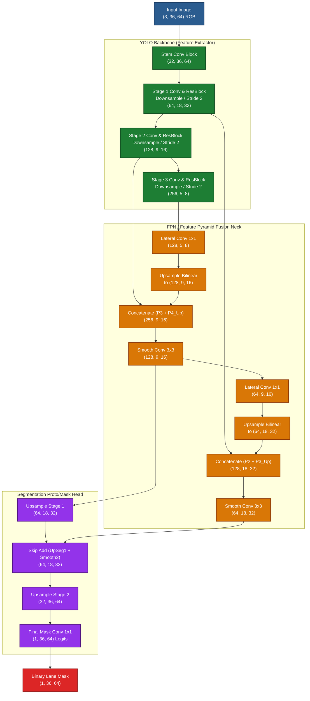

# Custom YOLO-seg Network Architecture

This document describes the architectural layout of the **Custom YOLO-seg** network created for single-class lane segmentation (`almondmatcha-lane-detection/segmentation`).

## Key Specifications
- **Input Resolution**: `64 x 36` RGB Image (`Batch x 3 x 36 x 64`)
- **Output Resolution**: `64 x 36` Binary Mask Logits (`Batch x 1 x 36 x 64`)
- **Target Task**: Pixel-wise lane segmentation from 1280x720 downsampled domain dataset.

---

## Mermaid Network Diagram

---

## Architectural Highlights

1. **Backbone**:
   - Uses strided convolutions with residual connections (YOLO style).
   - Downsamples image from 36x64 down to 5x8 while expanding feature channels from 3 to 256.
   - Activations are `SiLU` paired with `BatchNorm2d`.

2. **FPN Neck (Feature Pyramid Network)**:
   - Fuses multi-scale feature maps from low levels (fine-grained lane boundaries) and deep levels (semantic context).
   - Top-down feature upsampling ensures precise localization for thin lane lines.

3. **Segmentation Proto Head**:
   - Progressive upsampling layers bring spatial feature resolutions back to 36x64.
   - Outputs raw binary mask logits evaluated via `BCE + Dice Loss`.
